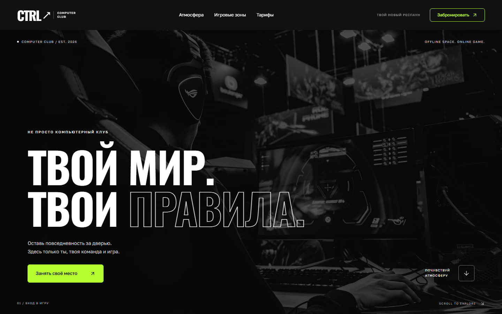

# CTRL CLUB — компьютерный клуб



Демо-сайт компьютерного клуба: тёмный кинематографичный hero, бегущая
строка, игровые зоны с ценами, 3D-эскиз ПК и бронирование места.
Задача — передать атмосферу ночного клуба и при этом не превратить
страницу в неоновую свалку.

**Live:** [ctrl-club-lyart.vercel.app](https://ctrl-club-lyart.vercel.app) ·
**Код:** [Zurux1337/PC-club](https://github.com/Zurux1337/PC-club)

## Что внутри

- **Hero** с контурной типографикой и одной лаймовой кнопкой.
- **Бегущая строка** на GSAP с бесшовным циклом.
- **Игровые зоны**: три карточки (соло, дуо, команда) с составом железа,
  ценой за час и кнопкой выбора зоны.
- **3D-эскиз ПК** на React Three Fiber: интерактивная модель в раскрывающейся
  панели, с fallback при `prefers-reduced-motion` и ошибке WebGL.
- **Бронирование** в диалоге: зона подставляется из карточки, форма проверяет
  имя и телефон.
- **Мобильное меню** с корректным `aria-expanded` и закрытием по выбору пункта.

## Дизайн

- Стиль: [`styles/references/defy.md`](../.opencode/skills/styles/references/defy.md) —
  чёрный фон `#111`, лайм `#b7ff2c` только на действиях, радиус 6px,
  без градиентов и «свечения ради свечения».
- Шрифты: Oswald (заголовки), Golos Text (текст).
- Фотографии обесцвечены: цвет остаётся только у акцента и контента.
- Контурный текст — второй уровень иерархии, а не декор.

## Стек

Next.js 16 · React 19 · TypeScript · Tailwind CSS 4 · shadcn/ui (Radix) ·
React Three Fiber + three · framer-motion · GSAP · Lenis · lucide-react

## Структура

```
app/
├─ layout.tsx        # шрифты, метаданные
├─ page.tsx          # hero, statement, atmosphere, zones, closing
├─ globals.css       # токены и стили
└─ icon.svg          # favicon
components/
├─ booking-dialog.tsx
├─ rig-preview.tsx   # 3D-модель ПК
└─ ui/               # button, dialog
lib/utils.ts
```

## Запуск

```bash
npm install
npm run dev      # http://127.0.0.1:3000
```

## Проверки

```bash
npm run lint
npm run typecheck
npm run build
npm start
```

## Демо-дисклеймер

Тарифы, комплектации и фотографии — демонстрационные. Форма бронирования
не отправляет данные и не резервирует место. 3D-модель — художественный
эскиз, а не точная конфигурация клуба.
